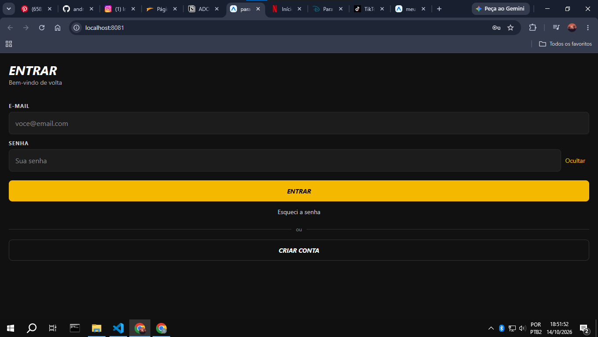

# Paradigmas mobile: web x mobile na prática

**Aluno:** André Luiz Jesus Martins
**Disciplina:** Programação para Dispositivos Móveis

## 1. Fundamentação

### 1.1 Ciclo de build e distribuição

**Na web:** quando eu altero o código, faço o deploy no servidor e a mudança já fica no ar. Na próxima vez que o usuário abrir o site, ele vê a versão nova, sem precisar fazer nada. Se aparece um bug, eu corrijo e subo de novo em poucos minutos.

**No mobile:** o app fica instalado no celular do usuário, então não basta subir para um servidor. Primeiro eu gero o build, depois envio para a App Store e para a Play Store. Lá a Apple e o Google revisam o app, o que pode levar de horas a dias, e eles podem recusar a versão. Depois de aprovada, o usuário ainda precisa atualizar. Quem não atualiza continua com a versão antiga, inclusive com o bug. Por isso o servidor precisa continuar funcionando com versões antigas do app.

### 1.2 Ciclo de vida do aplicativo

No celular, o app passa por estados. Ele fica **ativo** quando está na tela e eu estou usando. Quando troco de app ou bloqueio a tela, ele vai para **segundo plano**: continua na memória, mas o sistema limita o que ele pode fazer para economizar bateria. Se o celular precisar de memória, o sistema pode **encerrar o app sem avisar**, e na próxima vez ele abre do zero. Por isso o programador precisa salvar o que é importante (como um formulário preenchido) antes que isso aconteça.

Na web é diferente: uma aba em segundo plano continua aberta, o estado fica na página e quem decide fechar sou eu. No desktop também, o programa só fecha quando o usuário fecha, e o computador tem mais memória e energia.

### 1.3 Restrições do dispositivo

- **Bateria:** é limitada. App que gasta muita energia, como GPS ligado o tempo todo ou animações pesadas, irrita o usuário e pode ser limitado pelo sistema.
- **Memória:** é pequena comparada a um computador, e o sistema encerra apps quando precisa dela.
- **Rede:** é instável (elevador, metrô, área sem sinal). O app deve funcionar, ou pelo menos avisar com clareza, quando estiver sem internet. Na web costumamos assumir que a conexão existe.
- **Tela e orientação:** os tamanhos e a densidade de pixels variam muito, e o usuário pode girar o aparelho.
- **Notch e safe area:** o notch e as barras do sistema cobrem partes da tela. A safe area é a região que não é coberta por eles.
- **Permissões:** câmera, localização e notificações são pedidas na hora do uso, e o usuário pode negar. O app precisa continuar funcionando de algum jeito se a resposta for "não".

### 1.4 Entrada e interação

Na web e no desktop a entrada é mouse e teclado: o ponteiro é preciso, existe hover e há atalhos. No celular a entrada é o toque, que é impreciso porque o dedo é muito maior que a ponta de um cursor. Por isso existe um tamanho mínimo de área de toque: cerca de 44 pt nas diretrizes da Apple e 48 dp no Material Design. Botões menores geram toques errados.

Não existe hover, então nada importante pode depender dele. Em compensação existem gestos, como arrastar, pinça, toque longo e puxar para atualizar. Como eles não são óbvios, o app precisa ensinar ou oferecer uma alternativa visível.

O teclado virtual ocupa cerca de metade da tela e pode cobrir o campo que estou preenchendo. No React Native isso pode ser tratado com o `KeyboardAvoidingView`. No desktop o teclado é físico e não ocupa a tela.

### 1.5 UX mobile

O contexto de uso é diferente: muitas vezes a pessoa está em pé, no ônibus, com uma mão só e com pressa. Por isso a interface precisa ser simples e rápida. A zona do polegar é a área da tela que ele alcança com conforto, geralmente a parte de baixo, então as ações principais devem ficar ali. O topo é difícil de alcançar com uma mão.

Isso explica os padrões de navegação mobile: a tab bar inferior (poucas seções principais, sempre à mão), a navegação em pilha com botão de voltar e o menu lateral (drawer) para opções secundárias. Na web é comum o menu ficar no topo, o que no celular fica longe do polegar.

## 2. Pesquisa de campo: análise de 2 aplicativos

Como meu celular está quebrado, analisei os dois serviços pelo Chrome, comparando a versão de computador com o modo de emulação de celular (DevTools). Isso não substitui o app instalado, e o que não consegui testar está indicado abaixo.

### App 1: Netflix

- **Navegação:** no desktop o menu (Início, Séries, Filmes, Jogos...) aparece inteiro no topo. No modo celular ele some e sobram só a busca, o sino e o perfil, para caber na tela estreita.
- **Botões e polegar:** o botão "Assistir" virou uma barra larga, que ocupa quase a largura toda e é fácil de tocar. Já a busca, o sino e o perfil ficam no topo, longe do polegar numa mão só.
- **Permissões e app:** o Chrome mostrou "Notificações bloqueadas" na barra de endereço, ou seja, o site depende de permissão do usuário para notificar. Também vi que o site incentiva instalar o app. Não testei o uso sem internet; pelo que sei, o download de títulos para assistir offline só existe no app instalado.

### App 2: Disney+

- **Navegação:** no desktop o menu (Início, Ao Vivo, Minha Lista, Filmes, Séries, Originais) fica à mostra. No celular ele vira o ícone de três linhas (☰), que esconde as opções até o toque.
- **Botões e polegar:** o ☰ e a busca ficam no canto superior direito, uma área difícil de alcançar com uma mão só. O carrossel ganha setas nas laterais, mas no celular o gesto natural seria arrastar o dedo.
- **Permissões e app:** assim como a Netflix, o site pede para baixar o aplicativo no celular. Não testei o funcionamento sem internet nem as permissões do app instalado.

### Comparação web x app

Nos dois casos a versão web de celular é uma adaptação reduzida: menu escondido, controles principais no topo e convite constante para instalar o app, onde ficam recursos como download offline.

## 3. Prática: da web para o React Native

Reconstruí a **tela de login** do site da academia Ritmo Brasil (ritmobrasil-treino.netlify.app), que desenvolvi para (PROGRAMAÇÃO PARA DISPOSITIVOS MÓVEIS). O componente está em `src/components/LoginForm.js`, recebe `titulo`, `subtitulo` e `onEntrar` por props, usa `StyleSheet` com Flexbox e tem três estados com `useState`: o e-mail, a senha e o botão que mostra ou oculta a senha. Como meu celular está quebrado, rodei o projeto no navegador com Expo Web. Não reconstruí o logo nem a linha amarela do topo, só o formulário. Antes do login, fiz como teste um componente `Navbar` (`src/components/Navbar.js`) para validar o ambiente.

**Versão web (original):**

**Versão React Native (Expo Web):**

### Diferenças que encontrei

1. **Sem `div`, `p`, `input` e `button`:** usei `View`, `Text`, `TextInput` e `Pressable`. Todo texto precisa estar dentro de um `Text`.
2. **O campo de texto funciona diferente:** no HTML o `input` usa `onchange` e `type="password"`. No React Native o `TextInput` usa `onChangeText` e `secureTextEntry`, e o valor fica guardado no `useState`.
3. **`onPress` em vez de `onClick`:** e não existe `:hover`. O feedback visual é o estado de pressionado.
4. **`flexDirection` padrão é `column`:** na web é `row`. Para o campo de senha ficar ao lado do botão "Mostrar", precisei declarar `flexDirection: 'row'`.
5. **Estilos sem CSS e sem cascata:** vêm de `StyleSheet.create`, com objetos em camelCase (`backgroundColor`), números sem `px` e nada herdado do elemento pai. A cor do texto, por exemplo, tem que ser definida em cada `Text`.
6. **Tipo de teclado:** no campo de e-mail usei `keyboardType="email-address"`, que no celular abre um teclado com `@`. Na web isso não existe no mesmo formato.
7. **Rolagem e `SafeAreaView`:** a tela não rola sozinha, precisei envolver tudo em um `ScrollView`. E o `SafeAreaView` aparece riscado no VS Code porque está obsoleto (deprecated).
8. **Largura dos elementos:** na web um bloco ocupa a largura toda por padrão. No React Native, precisei de `flex: 1` para o `SafeAreaView` ocupar a tela.

## 4. Conclusão

Antes eu pensava em mobile como "o site em tela menor", e a pesquisa e a prática mostraram que não é isso. Na prática, o que eu achava que funcionava igual não funcionou: o `flexDirection` padrão é `column`, a barra ficou estreita até eu usar `flex: 1`, e todo texto precisou ir dentro de `Text`. Na análise da Netflix e da Disney+, vi que o menu some ou vira um ícone no celular e que os dois sites insistem em levar o usuário para o app. Daqui para frente, quero pensar primeiro no contexto de uso (uma mão, pouca atenção, rede ruim) e no tamanho do toque, e não só no layout. Também preciso lembrar que publicar um app passa por loja e revisão, e que o usuário pode continuar com uma versão antiga, então não dá para "corrigir e subir de novo" como na web.

## Referências

ESCUDELARIO, B.; PINHO, D. **React Native**: desenvolvimento de aplicativos mobile com React. São Paulo: Casa do Código, 2021.

APPLE. **Human Interface Guidelines**. Disponível em: https://developer.apple.com/design/human-interface-guidelines. Acesso em: 14 out. 2026.

GOOGLE. **Material Design 3**. Disponível em: https://m3.material.io. Acesso em: 14 out. 2026.

REACT NATIVE. **Documentação oficial**. Disponível em: https://reactnative.dev/docs/getting-started. Acesso em: 14 out. 2026.

## Declaração de uso de IA

ANTHROPIC. Claude (Sonnet 5.5). Ferramenta de inteligência artificial generativa.
Data de uso: 14 out. 2026.
Finalidade: orientação sobre a ordem de trabalho e o uso do Git; exemplos dos componentes Navbar e LoginForm; correção da largura da barra; texto-base das seções 1.2 a 1.5, da pesquisa de campo (seção 2), da lista de diferenças (seção 3) e da conclusão (seção 4).
Arquivos impactados: src/components/Navbar.js, src/components/LoginForm.js, App.js, README.md