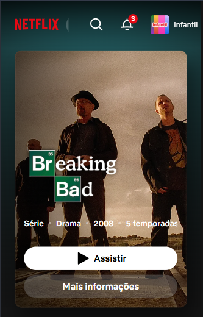
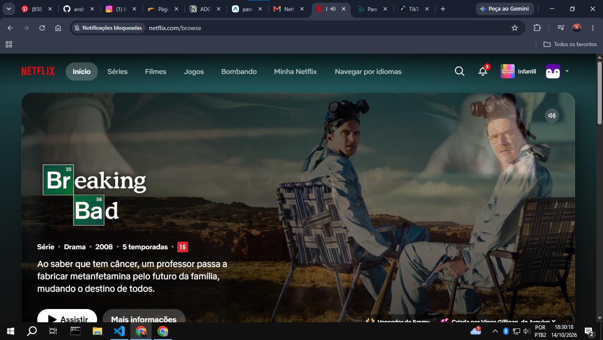
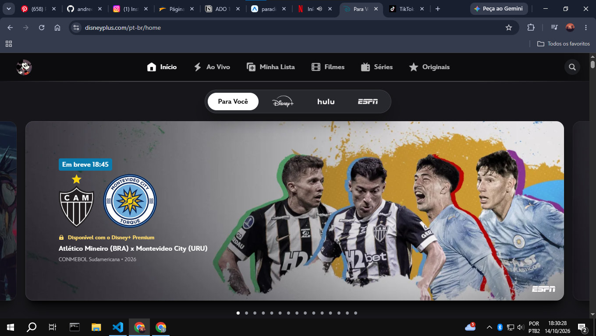

# Paradigmas mobile: web x mobile na prática

**Aluno:** André Luiz Jesus Martins
**Disciplina:** Programação para Dispositivos Móveis

## 1. Fundamentação

### 1.2 Ciclo de vida do aplicativo

No celular, o app passa por estados. Ele fica **ativo** quando está na tela e eu estou usando. Quando troco de app ou bloqueio a tela, ele vai para **segundo plano**: continua na memória, mas o sistema limita o que ele pode fazer para economizar bateria. Se o celular precisar de memória, o sistema pode **encerrar o app sem avisar**, e na próxima vez ele abre do zero. Por isso o programador precisa salvar o que é importante (como um formulário preenchido) antes que isso aconteça.

Na web é diferente: uma aba em segundo plano continua aberta, o estado fica na página e quem decide fechar sou eu. No desktop também, o programa só fecha quando o usuário fecha, e o computador tem mais memória e energia.

### 1.3 Restrições do dispositivo

- **Bateria:** é limitada. App que gasta muita energia, como GPS ligado o tempo todo ou animações pesadas, irrita o usuário e pode ser limitado pelo sistema.
- **Memória:** é pequena comparada a um computador, e o sistema encerra apps quando precisa dela.
- **Rede:** é instável (elevador, metrô, área sem sinal). O app deve funcionar, ou pelo menos avisar com clareza, quando estiver sem internet. Na web costumamos assumir que a conexão existe.
- **Tela e orientação:** os tamanhos e a densidade de pixels variam muito, e o usuário pode girar o aparelho.
- **Notch e safe area:** o notch e as barras do sistema cobrem partes da tela. A safe area é a região que não é coberta por eles.
- **Permissões:** câmera, localização e notificações são pedidas na hora do uso, e o usuário pode negar. O app precisa continuar funcionando de algum jeito se a resposta for "não".

### 1.4 Entrada e interação

Na web e no desktop a entrada é mouse e teclado: o ponteiro é preciso, existe hover e há atalhos. No celular a entrada é o toque, que é impreciso porque o dedo é muito maior que a ponta de um cursor. Por isso existe um tamanho mínimo de área de toque: cerca de 44 pt nas diretrizes da Apple e 48 dp no Material Design. Botões menores geram toques errados.

Não existe hover, então nada importante pode depender dele. Em compensação existem gestos, como arrastar, pinça, toque longo e puxar para atualizar. Como eles não são óbvios, o app precisa ensinar ou oferecer uma alternativa visível.

O teclado virtual ocupa cerca de metade da tela e pode cobrir o campo que estou preenchendo. No React Native isso pode ser tratado com o `KeyboardAvoidingView`. No desktop o teclado é físico e não ocupa a tela.

### 1.5 UX mobile

O contexto de uso é diferente: muitas vezes a pessoa está em pé, no ônibus, com uma mão só e com pressa. Por isso a interface precisa ser simples e rápida. A zona do polegar é a área da tela que ele alcança com conforto, geralmente a parte de baixo, então as ações principais devem ficar ali. O topo é difícil de alcançar com uma mão.

Isso explica os padrões de navegação mobile: a tab bar inferior (poucas seções principais, sempre à mão), a navegação em pilha com botão de voltar e o menu lateral (drawer) para opções secundárias. Na web é comum o menu ficar no topo, o que no celular fica longe do polegar.

## 2. Pesquisa de campo: análise de 2 aplicativos

Como meu celular está quebrado, analisei os dois serviços pelo Chrome, comparando a versão de computador com o modo de emulação de celular (DevTools). Isso não substitui o app instalado, e o que não consegui testar está indicado abaixo.

### App 1: Netflix

- **Navegação:** no desktop o menu (Início, Séries, Filmes, Jogos...) aparece inteiro no topo. No modo celular ele some e sobram só a busca, o sino e o perfil, para caber na tela estreita.
- **Botões e polegar:** o botão "Assistir" virou uma barra larga, que ocupa quase a largura toda e é fácil de tocar. Já a busca, o sino e o perfil ficam no topo, longe do polegar numa mão só.
- **Permissões e app:** o Chrome mostrou "Notificações bloqueadas" na barra de endereço, ou seja, o site depende de permissão do usuário para notificar. Também vi que o site incentiva instalar o app. Não testei o uso sem internet; pelo que sei, o download de títulos para assistir offline só existe no app instalado.

### App 2: Disney+

- **Navegação:** no desktop o menu (Início, Ao Vivo, Minha Lista, Filmes, Séries, Originais) fica à mostra. No celular ele vira o ícone de três linhas (☰), que esconde as opções até o toque.
- **Botões e polegar:** o ☰ e a busca ficam no canto superior direito, uma área difícil de alcançar com uma mão só. O carrossel ganha setas nas laterais, mas no celular o gesto natural seria arrastar o dedo.
- **Permissões e app:** assim como a Netflix, o site pede para baixar o aplicativo no celular. Não testei o funcionamento sem internet nem as permissões do app instalado.

### Comparação web x app

Nos dois casos a versão web de celular é uma adaptação reduzida: menu escondido, controles principais no topo e convite constante para instalar o app, onde ficam recursos como download offline.

## 3. Prática: da web para o React Native

Reconstruí a **Navbar** da minha página web como o componente `src/components/Navbar.js`, que recebe `titulo` e `links` por props, usa `StyleSheet` e Flexbox, e tem um menu que abre e fecha com `useState`. Como meu celular está indisponível, rodei o projeto no navegador com Expo Web, em modo de emulação de celular.

(Coloque aqui o print da versão web original ao lado do print do app rodando)

### Diferenças que encontrei

1. **Largura do elemento:** na web, um bloco ocupa a largura toda por padrão. No React Native a barra ficou estreita até eu colocar `flex: 1` no `SafeAreaView`.
2. **Sem `div`, `p` e `button`:** usa-se `View`, `Text` e `Pressable`, e todo texto precisa estar dentro de `Text`.
3. **`onPress` em vez de `onClick`:** e não existe `:hover`, o feedback é o estado de pressionado.
4. **`flexDirection` padrão é `column`:** na web é `row`. Para a barra ficar horizontal precisei declarar `flexDirection: 'row'`.
5. **Estilos sem cascata e sem CSS:** vêm de `StyleSheet.create`, com objetos em camelCase (`backgroundColor`), valores sem `px` e nada herdado do elemento pai.
6. **`SafeAreaView` obsoleto:** o VS Code mostrou o componente riscado, porque ele está deprecated; hoje se recomenda o da biblioteca `react-native-safe-area-context`.

## 4. Conclusão

(Escreva aqui 1 parágrafo seu: o que você precisa mudar na forma de pensar ao desenvolver para mobile?)

## Referências

ESCUDELARIO, B.; PINHO, D. **React Native**: desenvolvimento de aplicativos mobile com React. São Paulo: Casa do Código, 2021.

APPLE. **Human Interface Guidelines**. Disponível em: https://developer.apple.com/design/human-interface-guidelines. Acesso em: 14 out. 2026.

GOOGLE. **Material Design 3**. Disponível em: https://m3.material.io. Acesso em: 14 out. 2026.

REACT NATIVE. **Documentação oficial**. Disponível em: https://reactnative.dev/docs/getting-started. Acesso em: 14 out. 2026.

## Declaração de uso de IA

ANTHROPIC. Claude (Sonnet 5.5). Ferramenta de inteligência artificial generativa.
Data de uso: 14 out. 2026.
Finalidade: orientação sobre a ordem de trabalho, exemplo do componente Navbar, correção da largura da barra e texto-base das seções 1.2 a 1.5 e da lista de diferenças.
Arquivos impactados: src/components/Navbar.js, App.js, README.md